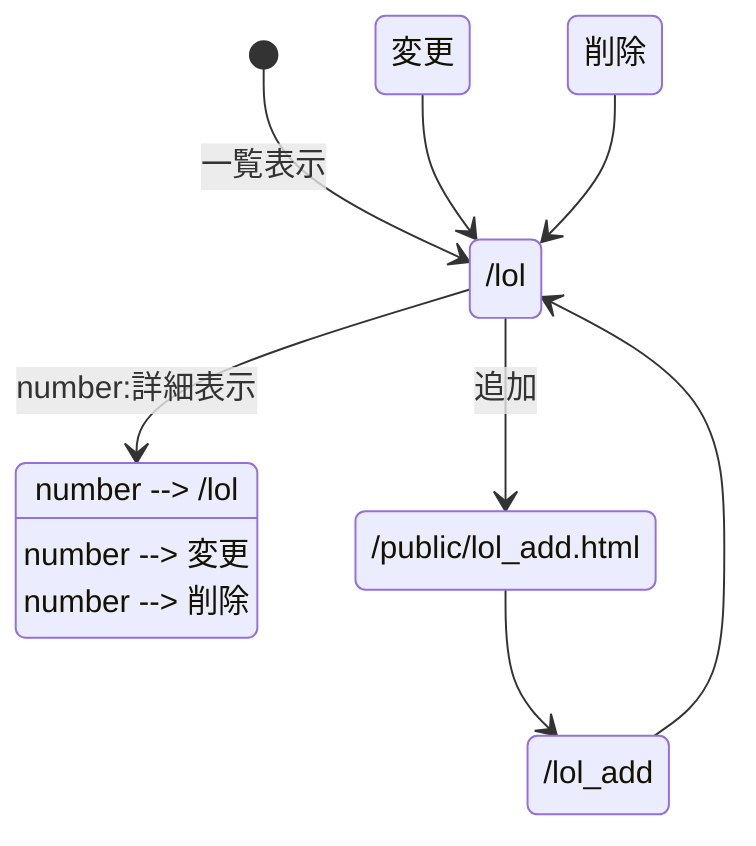
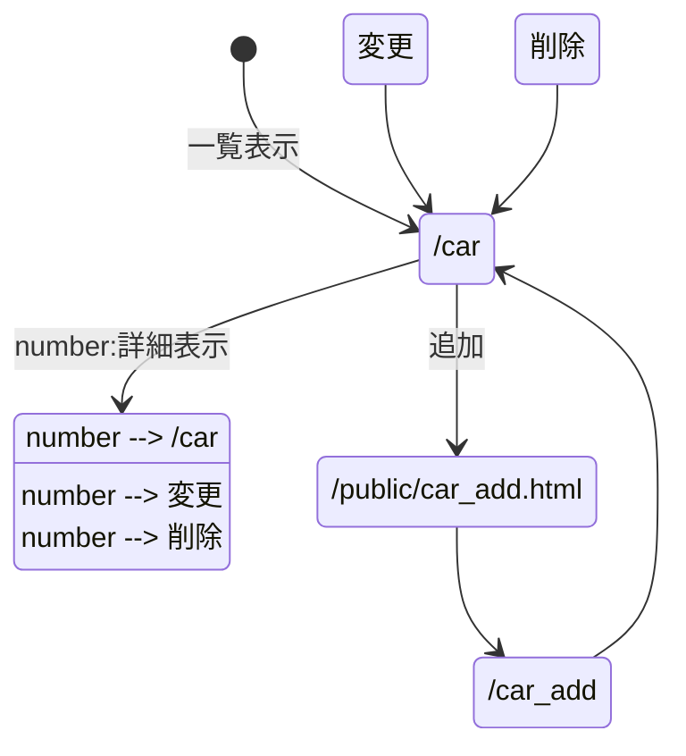
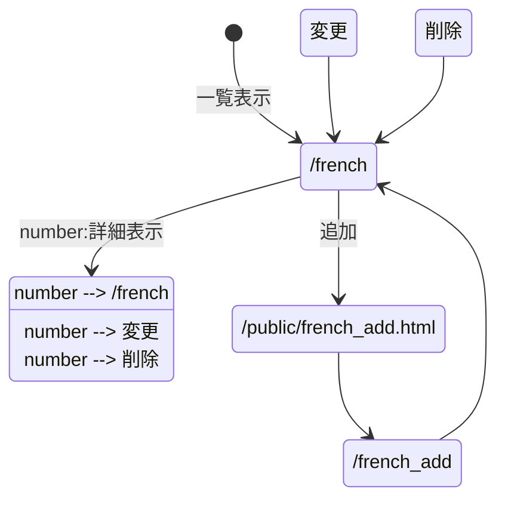

# レポート用システムの設計

京葉線システム以外に，以下の3つのWebアプリケーションを開発する．
いずれも一覧表示をベースとし，データの一覧・詳細表示，追加，削除，変更を行う．
データはサーバの変数内に記録する．

1. LoLのチーム管理システム
2. スポーツカー管理システム
3. フレンチの料理管理システム

---

## 1. LoLのチーム管理システム

### 対象
League of Legends（LoL）のプロチームの情報を管理する．
利用者は，チームの一覧から各チームの所属リーグや略称を確認できる．

### スキーマ
| 項目名 | 型 | 説明 | 例 |
|---|---|---|---|
| id | 数値 | チームの番号 | 1 |
| team | 文字列 | チーム名 | T1 |
| region | 文字列 | 所属する地域リーグ | LCK |
| code | 文字列 | チームの略称 | T1 |
| founded | 数値 | 設立年 | 2004 |

### ページ遷移

---

## 2. スポーツカー管理システム

### 対象
スポーツカーの情報を管理する．
利用者は，車の一覧から各車のメーカーや性能を確認できる．

### スキーマ
| 項目名 | 型 | 説明 | 例 |
|---|---|---|---|
| id | 数値 | 車の番号 | 1 |
| name | 文字列 | 車名 | マスタング |
| maker | 文字列 | メーカー | フォード |
| country | 文字列 | メーカーの国 | アメリカ |
| power | 数値 | 最高出力（馬力） | 486 |
| price | 数値 | 価格（万円） | 837 |

### ページ遷移

---

## 3. フレンチの料理管理システム

### 対象
フランス料理（フレンチ）のメニューを管理する．
利用者は，料理の一覧から各料理の種類や主な食材，価格を確認できる．

### スキーマ
| 項目名 | 型 | 説明 | 例 |
|---|---|---|---|
| id | 数値 | 料理の番号 | 1 |
| name | 文字列 | 料理名 | ブイヤベース |
| course | 文字列 | コースでの位置（前菜，スープ，魚料理，肉料理，デザート） | 魚料理 |
| ingredient | 文字列 | 主な食材 | 魚介類 |
| price | 数値 | 価格（円） | 3200 |

### ページ遷移

※変更と削除のURLは，次回以降に学習するREST APIに合わせて決める．
