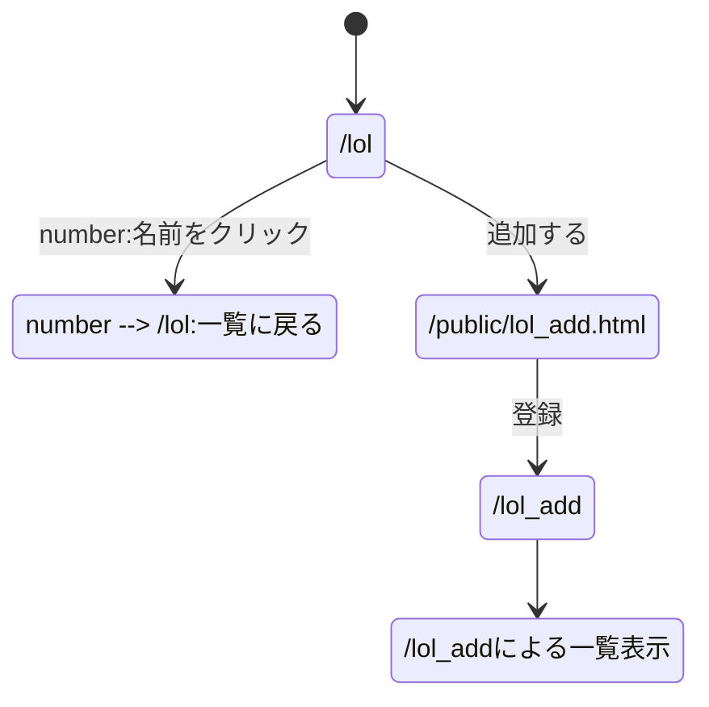
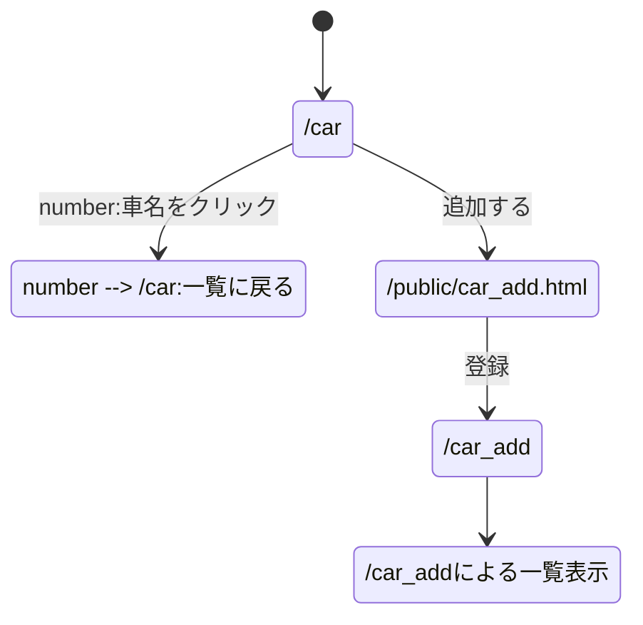
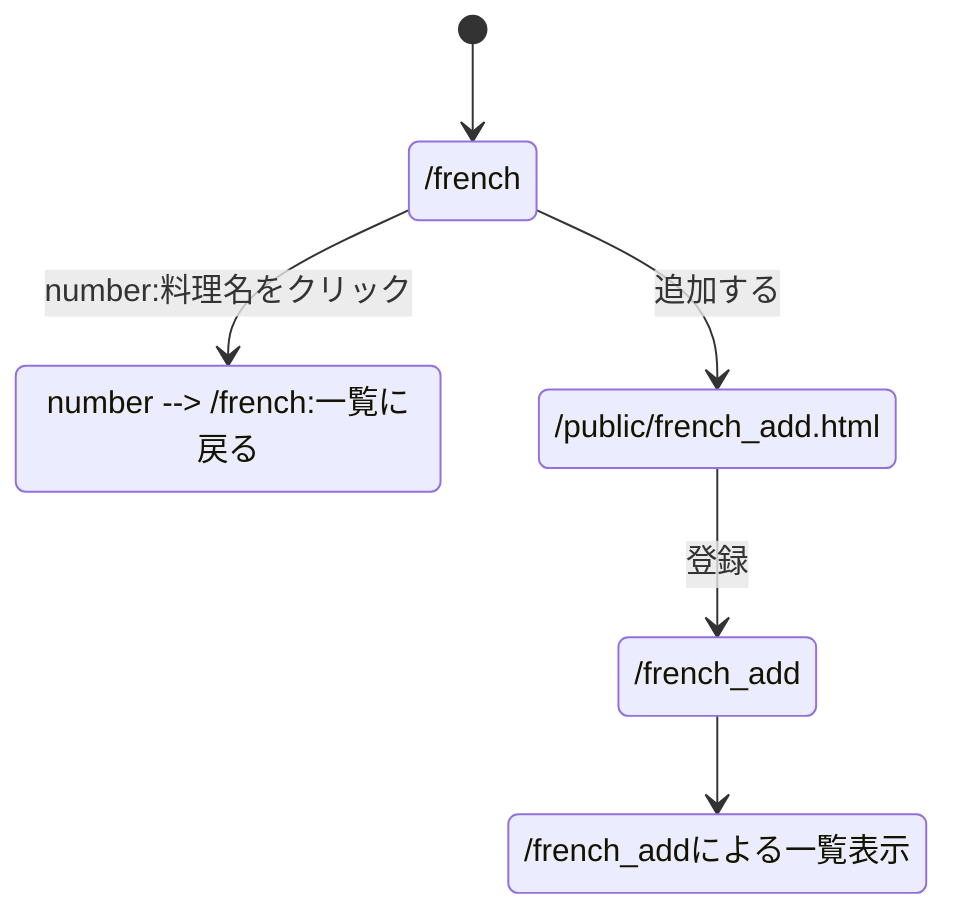

# 基本的なデータ表示のWebアプリ 仕様書

- 作成者：大島慈英（26G1027）
- ソースコード：https://github.com/nemu-j/webpro_06
- プログラム：`report.js`

本システムは，以下の3つのWebアプリケーションから構成される．

| アプリ | 内容 | 一覧ページのURL |
|---|---|---|
| LoLのチーム | League of Legendsのプロチームの情報 | `/lol` |
| スポーツカー | スポーツカーの性能などの情報 | `/car` |
| フレンチ | フランス料理のメニューの情報 | `/french` |

※現在は一覧表示，詳細表示，追加を実装している．削除と変更は今後実装する．

---

# 第1部 利用者向け

## 1.1 一覧を見る
Webブラウザで以下のURLを開くと，データの一覧が表で表示される．

- LoLのチーム：http://localhost:8080/lol
- スポーツカー：http://localhost:8080/car
- フレンチ：http://localhost:8080/french

## 1.2 詳細を見る
一覧の中の名前（チーム名，車名，料理名）をクリックすると，そのデータの詳細ページが表示される．
詳細ページの下にあるリンクをクリックすると，一覧に戻る．

## 1.3 データを追加する
1. 一覧の下にある「追加する」をクリックする．
2. 入力欄にすべての項目を入力する．空欄があると登録できない．
3. 「登録」ボタンを押す．
4. 追加したデータを含む一覧が表示される．

## 1.4 データを削除・変更する
今後実装する予定である．

---

# 第2部 管理者向け

## 2.1 動作環境
- Node.js
- 使用パッケージ：express，ejs（`package.json` に記載）

## 2.2 インストールと起動
```
git clone https://github.com/nemu-j/webpro_06.git
cd webpro_06
npm install
node report.js
```
`Example app listening on port 8080!` と表示されれば起動している．
ポート番号は8080である．

## 2.3 停止
サーバを起動したターミナルで control + C を押す．

## 2.4 データについて
- データはサーバの変数内に記録している．データベースは使用していない．
- そのため，**サーバを停止すると追加したデータは消え**，起動時のデータに戻る．
- 起動時のデータを変更する場合は，`report.js` の変数 `lol`，`car`，`french` を編集する．

---

# 第3部 開発者向け

## 3.1 ファイル構成
| ファイル | 役割 |
|---|---|
| `report.js` | サーバのプログラム．データの定義と各URLの処理 |
| `views/lol_list.ejs` | LoLのチーム一覧のテンプレート |
| `views/lol_detail.ejs` | LoLのチーム詳細のテンプレート |
| `public/lol_add.html` | LoLのチーム追加フォーム |
| `views/car_list.ejs` | スポーツカー一覧のテンプレート |
| `views/car_detail.ejs` | スポーツカー詳細のテンプレート |
| `public/car_add.html` | スポーツカー追加フォーム |
| `views/french_list.ejs` | フレンチのメニュー一覧のテンプレート |
| `views/french_detail.ejs` | フレンチの料理詳細のテンプレート |
| `public/french_add.html` | フレンチの料理追加フォーム |

## 3.2 URLと処理の一覧
| URL | 処理 | 使用するテンプレート等 |
|---|---|---|
| `/lol` | チームの一覧を表示する | `lol_list.ejs` |
| `/lol/:number` | 配列の `number` 番目のチームの詳細を表示する | `lol_detail.ejs` |
| `/public/lol_add.html` | チームの追加フォームを表示する | `lol_add.html` |
| `/lol_add` | クエリパラメータで受け取ったチームを追加し，一覧を表示する | `lol_list.ejs` |
| `/car` | 車の一覧を表示する | `car_list.ejs` |
| `/car/:number` | 配列の `number` 番目の車の詳細を表示する | `car_detail.ejs` |
| `/public/car_add.html` | 車の追加フォームを表示する | `car_add.html` |
| `/car_add` | クエリパラメータで受け取った車を追加し，一覧を表示する | `car_list.ejs` |
| `/french` | 料理の一覧を表示する | `french_list.ejs` |
| `/french/:number` | 配列の `number` 番目の料理の詳細を表示する | `french_detail.ejs` |
| `/public/french_add.html` | 料理の追加フォームを表示する | `french_add.html` |
| `/french_add` | クエリパラメータで受け取った料理を追加し，一覧を表示する | `french_list.ejs` |

- 詳細ページの `:number` はidではなく，配列の番号（0から始まる）である．`req.params.number` で受け取る．
- 追加では，値を `req.query` で受け取る．数値の項目は `Number()` で数値に変換してから記録する．

## 3.3 スキーマ

### LoLのチーム（変数 `lol`）
| 項目名 | 型 | 説明 | 例 |
|---|---|---|---|
| id | 数値 | チームの番号 | 1 |
| team | 文字列 | チーム名 | T1 |
| region | 文字列 | 所属する地域リーグ | LCK |
| code | 文字列 | チームの略称 | T1 |
| country | 文字列 | 拠点の国・地域 | 韓国 |

### スポーツカー（変数 `car`）
| 項目名 | 型 | 説明 | 例 |
|---|---|---|---|
| id | 数値 | 車の番号 | 1 |
| name | 文字列 | 車名 | マスタング GT |
| maker | 文字列 | メーカー | フォード |
| country | 文字列 | メーカーの国 | アメリカ |
| engine | 文字列 | エンジン形式 | 5.0L V8 |
| power | 数値 | 最高出力（PS） | 486 |

### フレンチの料理（変数 `french`）
| 項目名 | 型 | 説明 | 例 |
|---|---|---|---|
| id | 数値 | 料理の番号 | 1 |
| name | 文字列 | 料理名 | ブイヤベース |
| course | 文字列 | コースでの位置 | 魚料理 |
| ingredient | 文字列 | 主な食材 | 魚介類 |
| price | 数値 | 価格（円） | 3200 |

## 3.4 ページ遷移

### LoLのチーム


### スポーツカー


### フレンチ


## 3.5 授業で説明していない技術
現在のところ，授業で説明した技術のみを使用している．

## 3.6 今後の予定
- REST APIによる削除と変更の実装
